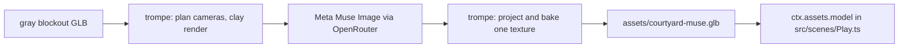

# trompe-yard

A gray blockout courtyard that an image model painted, then walked in ThreeNative.

The question: can a cheap image model give simple level geometry a realistic look, with no extra
polygons? Yes for walls seen from a few metres. The floor at the player's feet stays soft.

## Pipeline



- Painter: [trompe](https://github.com/Patch-gg/trompe) (Apache-2.0), with `tools/trompe-openrouter-muse.patch`.
  The patch adds a `muse-image` model and a dev-server proxy that reads `OPENROUTER_API_KEY`.
- OpenRouter's `/api/v1/images` takes the source image as `input_references`. It drops an `images`
  field without an error and paints from the text only, so the geometry is lost.
- Level: trompe's `samples/courtyard.glb`. Style: "an abandoned Soviet industrial courtyard".

## Run of 2026-11-23

| Value | Result |
| --- | --- |
| Views | 40 (24 player, 6 aerial, 6 hole, rest fill), all Muse |
| Cost | $0.40 ($0.01 per view) |
| Time | 12 min on an RTX 2080 |
| Level coverage | 56 % of the surface painted |
| Baked GLB | 20 MB source, 484 KB after the asset cook (KTX2) |

## Reproduce

```sh
git clone https://github.com/Patch-gg/trompe && cd trompe
git apply ../trompe-yard/tools/trompe-openrouter-muse.patch
npm install && npx playwright install chromium
OPENROUTER_API_KEY=... node scripts/texture.mjs --level samples/courtyard.glb --id muse-court \
  --views 24 --aerial 6 --holes 6 --first muse-image --fill muse-image \
  --style "an abandoned Soviet industrial courtyard: stained grey concrete walls, rusted steel, cracked asphalt and weathered brick"
cp runs/muse-court/level_textured.glb ../trompe-yard/assets/courtyard-muse.glb
```

Then `pnpm dev` here. The first start cooks the GLB for about 36 s.

## Proof

`playtests/courtyard.playtest.json` walks in from the spawn and asserts the baked texture is bound,
the player moves and the console has no errors. It passed headed on hardware WebGPU (NVIDIA Turing).
